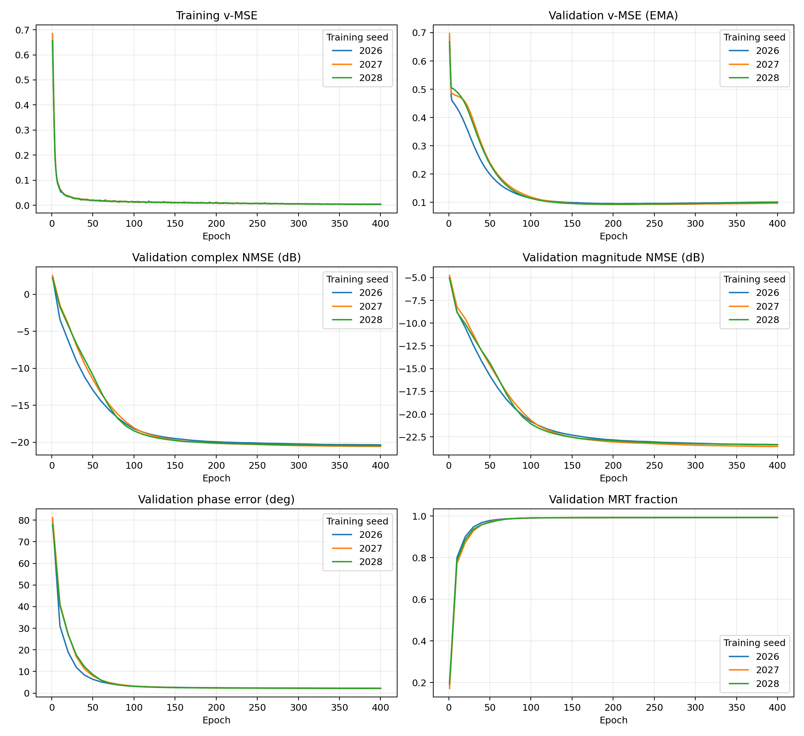

# Position-Conditioned Diffusion for Sparse-Pilot CSI Reconstruction

Conditional diffusion for same-location complex CSI completion in an 8-transmit-antenna / 1-receive-antenna downlink MISO setting, using DeepMIMO ray-tracing channels.

Given three observed subcarriers per transmit antenna and relative receiver-transmitter XYZ, the model reconstructs the thirteen missing subcarriers. This is **frequency completion at an observed location**, not CSI prediction at unobserved spatial locations and not a claim of exact reproduction of 3D-RadioDiff.

## Task

| Item | Setting |
| --- | --- |
| Base station / UAV | 8 TX antennas / 1 RX antenna |
| Array | Half-wavelength ULA, fixed orientation |
| Selected subcarriers | 16 |
| Observed subcarrier indices | `[0, 8, 15]` on the selected axis |
| Observations | 24 complex pilot coefficients and relative XYZ |
| Prediction targets | 104 complex coefficients: 8 antennas x 13 missing frequencies |
| Representation | Real and imaginary parts; amplitude and phase are derived from complex CSI |
| Main model | One shared frequency U-Net applied independently to each antenna |
| Diffusion | v prediction, zero-terminal-SNR schedule, T=200, known-pilot clamp, EMA |

Per-antenna pilot CSI is assumed to have been separated by noiseless orthogonal sounding. Three pilot frequencies do **not** mean that three scalar transmissions identify all eight TX channels. For example, eight orthogonal time slots at each of three frequencies require the channel to remain constant during sounding.

## Results

All methods use the same 16,000-point test set. Only the thirteen missing subcarriers are scored. Lower NMSE and phase error are better; higher MRT efficiency is better.

| Method | Complex NMSE (dB) | Magnitude NMSE (dB) | Phase error (deg) | Inter-antenna phase error (deg) | MRT efficiency |
| --- | ---: | ---: | ---: | ---: | ---: |
| **Shared-antenna diffusion + XYZ** | **-10.157** | **-12.845** | **9.426** | **7.634** | **96.44%** |
| LS RI interpolation | 2.762 | -9.333 | 101.387 | 8.194 | 96.28% |
| Raw LMMSE | 15.033 | 14.455 | 75.820 | 32.995 | 74.31% |
| Relative-ridge LMMSE | 1.398 | -6.058 | 79.517 | 43.552 | 71.73% |
| GMM-MMSE without position | 1.057 | -6.090 | 79.892 | 46.944 | 69.00% |
| GMM-MMSE with XYZ | 1.059 | -6.094 | 79.896 | 47.038 | 68.90% |

The diffusion model improves CSI reconstruction over these implemented baselines. MRT efficiency is approximately tied with LS interpolation; a substantial beamforming improvement has **not** been demonstrated. Both selected GMM models have K=1; these results are not a comparison against fully optimized GMM or theoretical optimal MMSE.

See [evaluation protocol](docs/evaluation.md), [machine-readable results](results/comparison.json), and the complete per-run records in `results/runs/`.

Recompute this table from the archived metrics without data or checkpoints:

```sh
python scripts/summarize_results.py
```



## Installation

The recorded training environment is Python 3.8, PyTorch 2.1.2+cu118 and NumPy 1.24.4. Dataset generation used a separate Python 3.11 environment with DeepMIMO 4.0.3. The following commands are run from the repository root; activation syntax depends on your shell.

```sh
conda create -n csi-diffusion python=3.8 -y
conda activate csi-diffusion
python -m pip install torch==2.1.2 --index-url https://download.pytorch.org/whl/cu118
python -m pip install -r requirements.txt
python -m unittest discover -s tests -v
```

## Dataset Preparation

Raw scenario files, generated channels, virtual environments and checkpoints are not distributed in this repository. The existing generation script requires a local single-antenna reference export as well as the official DeepMIMO scenario. This first release does **not** provide a one-command, reference-free dataset bootstrap. See [dataset format and prerequisites](docs/dataset.md) before training.

```sh
conda create -n deepmimo-data python=3.11 -y
conda activate deepmimo-data
python -m pip install -r requirements-data.txt
python scripts/generate_deepmimo.py --source /path/to/siso_reference --scenarios /path/to/deepmimo_scenarios --output datasets/deepmimo_o1_drone_200_8x1
```

Alternatively, place an already-generated compatible dataset in `datasets/deepmimo_o1_drone_200_8x1`. Do not copy the small archived dataset metadata into a new experiment as a substitute for actual channel files.

## Training and Baselines

Activate the training environment and run:

```sh
python scripts/train.py --mode independent --seed 2027 --epochs 400 --timesteps 200 --output runs/shared/seed_2027
python scripts/train.py --mode independent --seed 2028 --epochs 400 --timesteps 200 --output runs/shared/seed_2028
python scripts/run_baselines.py
```

Use the same training command with `--resume` to restore full optimizer, scheduler, scaler, EMA and RNG state. Baseline fitting refuses to overwrite an existing output directory. GMM fitting can require substantial RAM. The optional `--mode joint` model concatenates antenna channels; it is a separate architectural control, not the model in the headline row.

```sh
python scripts/diagnose.py --run runs/shared/seed_2027
```

Training records are historical exports, not downloadable model weights. Legacy matrix/report/audit scripts preserve the original experiment layout and may require omitted checkpoints, protected-artifact manifests or reference files. Use `train.py`, `predict.py` and `run_baselines.py` for the portable entry points. See [release notes](docs/release.md).

## Pilot-Only Inference

Supply a trusted locally trained `best.pt` and an NPZ containing:

- `pilot_real`, `pilot_imag`: `[point, 8, 3]`, in the fixed antenna/pilot order, original channel units.
- `relative_xyz`: `[point, 3]`, receiver minus transmitter coordinates in meters.

```sh
python scripts/predict.py --checkpoint runs/shared/seed_2027/best.pt --observations observations.npz --output predictions.npz
```

The output contains full `[point, 8, 16]` complex CSI and unit-norm complex MRT weights. The thirteen missing target coefficients are never inference inputs. Checkpoints and pickle files must only be loaded from trusted sources.

## Limitations and Attribution

- One DeepMIMO scenario and one fixed spatial split; training-seed repeats do not establish generalization to new scenes.
- No pilot measurement noise, RF calibration errors, coordinate noise, antenna coupling or UAV motion.
- No explicit cross-antenna feature mixing in the main shared model.
- MRT evaluates idealized received power, not BER or an end-to-end noisy communication link.
- Dataset generation uses [DeepMIMO](https://deepmimo.net/); original data terms remain applicable. No raw DeepMIMO data are redistributed here.
- The research direction is inspired by 3D-RadioDiff. The current task and code are an independent CSI frequency-completion extension, not the original paper's full radio-map reconstruction task.

No open-source license has been selected for this initial private release. Do not assume permission to redistribute third-party data or reference implementations.
