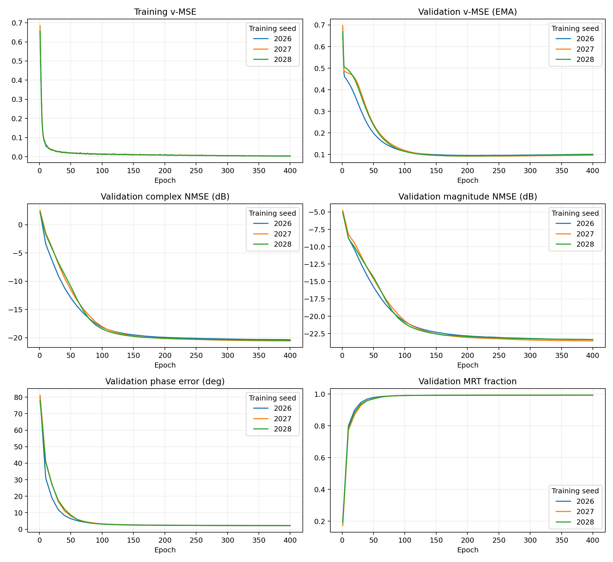

# Shared-Antenna Diffusion: Three Training Seeds

DeepMIMO downlink 8-TX / 1-RX MISO; three observed frequencies per transmit antenna plus relative XYZ.
Original 16000 / 8000 / 16000 spatial train/validation/test partitions are unchanged.
Original seed 2026 is reused unchanged; seeds 2027 and 2028 are independently trained from random initialization.
T=200, 400-epoch cap, original validation-only checkpoint selection and 30-epoch patience remain unchanged.
Test metrics score only the 13 missing frequencies; the three observed pilot frequencies are excluded.
Within each run, three sampling-seed metric values are averaged. Mean +/- sample SD below is across three TRAINING seeds, not nine training runs.
No seed selection or prediction ensembling is used.

## Per-Seed Test Results

| Training seed | Best epoch | Completed epochs | Complex NMSE (dB) | Magnitude NMSE (dB) | Phase (deg) | Strong phase (deg) | Inter-antenna phase (deg) | MRT fraction | MRT loss (dB) |
| --- | ---: | ---: | ---: | ---: | ---: | ---: | ---: | ---: | ---: |
| 2026 | 400 | 400 | -7.504 | -11.847 | 15.164 | 14.299 | 7.961 | 0.964 | 0.159 |
| 2027 | 400 | 400 | -9.783 | -13.219 | 10.215 | 9.727 | 7.980 | 0.960 | 0.177 |
| 2028 | 400 | 400 | -10.532 | -12.470 | 8.637 | 9.080 | 7.288 | 0.969 | 0.138 |

## Comparison With Frozen Baselines

| Method | Complex NMSE (dB) | Magnitude NMSE (dB) | Phase (deg) | Strong phase (deg) | Inter-antenna phase (deg) | MRT fraction | MRT loss (dB) |
| --- | ---: | ---: | ---: | ---: | ---: | ---: | ---: |
| Shared independent diffusion + XYZ | -9.273 +/- 1.577 | -12.512 +/- 0.687 | 11.339 +/- 3.406 | 11.035 +/- 2.845 | 7.743 +/- 0.394 | 0.964 +/- 0.004 | 0.158 +/- 0.020 |
| LS RI interpolation | 2.762 | -9.333 | 101.387 | 100.297 | 8.194 | 0.963 | 0.164 |
| Joint raw LMMSE | 15.033 | 14.455 | 75.820 | 73.159 | 32.995 | 0.743 | 1.290 |
| Joint relative-ridge LMMSE | 1.398 | -6.058 | 79.517 | 76.467 | 43.552 | 0.717 | 1.443 |
| GMM-MMSE no position (K=1) | 1.057 | -6.090 | 79.892 | 76.931 | 46.944 | 0.690 | 1.612 |
| GMM-MMSE XYZ (K=1) | 1.059 | -6.094 | 79.896 | 76.945 | 47.038 | 0.689 | 1.618 |

## Validation / Test Gap

| Training seed | Full validation NMSE (dB) | Full validation phase (deg) | Test NMSE (dB) | Test phase (deg) |
| --- | ---: | ---: | ---: | ---: |
| 2026 | -20.150 | 2.351 | -7.504 | 15.164 |
| 2027 | -20.353 | 2.251 | -9.783 | 10.215 |
| 2028 | -20.236 | 2.285 | -10.532 | 8.637 |

MRT fraction is true-channel-energy-weighted received-power efficiency relative to oracle CSI MRT at fixed total transmit power; it is not BER or prediction accuracy.
The existing GMM grid and fitted baseline models are unchanged; both selected GMM models have K=1. This is not a comparison against fully optimized GMM or theoretical optimal MMSE.
Training-seed variability measures optimization stability on one fixed dataset/split, not generalization to new scenes or independent spatial holdouts.
No pilot measurement noise, RF calibration errors, coordinate noise or UAV dynamics are added in this extension.
All protected old experiment files, frozen core/data hashes and validation indices passed preservation checks.

